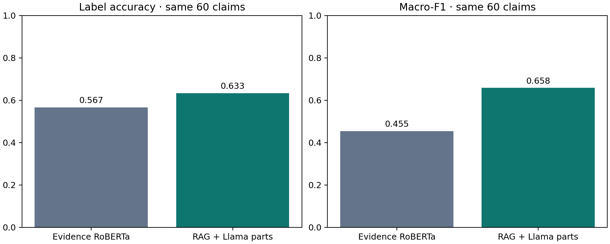
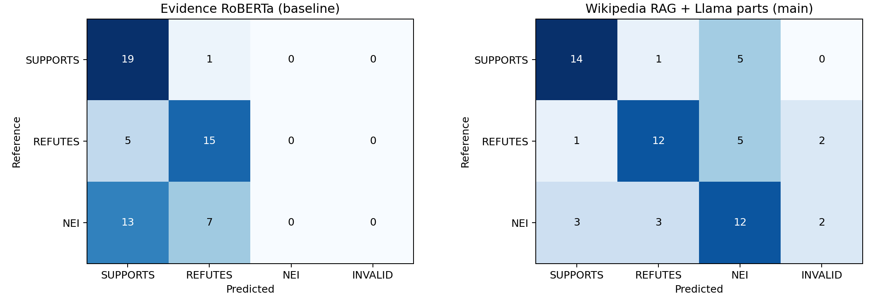

# Result Analysis: Wikipedia RAG with essential-part verdicts

## 1. Matched results

Both systems evaluated the same 60 fresh eligible internal test claims, balanced across the three FEVER labels. This is a small system comparison, not full test-partition performance.

| System | N | Accuracy | Macro-F1 | INVALID | Mean seconds |
|---|---:|---:|---:|---:|---:|
| Evidence RoBERTa (baseline) | 60 | 56.67% | 0.4548 | 0 | 0.14 |
| Wikipedia RAG + Llama parts (main) | 60 | 63.33% | 0.6583 | 4 | 58.76 |
| Llama's overall label (diagnostic) | 60 | 63.33% | 0.6544 | 4 | same call as main |

The main prediction is derived from the essential-part verdicts. The model-provided overall label is shown separately. Neither system receives reference labels. INVALID outputs remain incorrect and stay in the denominator.

## 2. Quantitative analysis

The observed accuracy difference is +6.67 percentage points; macro-F1 difference is +0.2035. The paired claim-bootstrap 95% accuracy-difference interval is [-10.00, +21.67] percentage points. The interval includes zero, so a reliable accuracy gain is not established.

The main system corrected 14 baseline mistakes and introduced 10 new mistakes. Model/derived-label disagreements: 4.

| System | Label | Precision | Recall | F1 |
|---|---|---:|---:|---:|
| Evidence RoBERTa (baseline) | SUPPORTS | 0.514 | 0.950 | 0.667 |
| Evidence RoBERTa (baseline) | REFUTES | 0.652 | 0.750 | 0.698 |
| Evidence RoBERTa (baseline) | NOT ENOUGH INFO | 0.000 | 0.000 | 0.000 |
| Wikipedia RAG + Llama parts (main) | SUPPORTS | 0.778 | 0.700 | 0.737 |
| Wikipedia RAG + Llama parts (main) | REFUTES | 0.750 | 0.600 | 0.667 |
| Wikipedia RAG + Llama parts (main) | NOT ENOUGH INFO | 0.545 | 0.600 | 0.571 |
| Llama's overall label (diagnostic) | SUPPORTS | 0.778 | 0.700 | 0.737 |
| Llama's overall label (diagnostic) | REFUTES | 0.700 | 0.700 | 0.700 |
| Llama's overall label (diagnostic) | NOT ENOUGH INFO | 0.556 | 0.500 | 0.526 |

## 3. Qualitative evidence

The examples below are selected by paired correctness, not a representative error-rate sample. A citation ID passing validation proves source membership, not sound reasoning. Failure attribution needs inspection of the supplied excerpts; absence of support alone is not refutation.

### Main correct, baseline wrong

**Claim 62400:** In Secret was based in 1911.

Reference: NOT ENOUGH INFO. Baseline: SUPPORTS. Main: NOT ENOUGH INFO.

- Part: In Secret was based in 1911. → **NOT ENOUGH INFO**. No information about the release or creation of the song 'Secret Secret' in 1911 is provided. Citations: none.

Full input and response: `traces/parts_rag/62400.json`.

**Claim 86869:** The Netherlands hosts the Oscars.

Reference: NOT ENOUGH INFO. Baseline: SUPPORTS. Main: NOT ENOUGH INFO.

- Part: The Netherlands hosts the Oscars. → **NOT ENOUGH INFO**. No evidence directly supports or contradicts the claim that the Netherlands hosts the Oscars. Citations: none.

Full input and response: `traces/parts_rag/86869.json`.

### Baseline correct, main wrong

**Claim 45888:** Lil Wayne's sixth album came out in 2008.

Reference: SUPPORTS. Baseline: SUPPORTS. Main: REFUTES.

- Part: Lil Wayne's sixth album came out in 2008. → **REFUTES**. E6 states that Tha Carter III was released in 2008, which is the sixth studio album by Lil Wayne. Citations: E6.

Evidence E6 — [Lil Wayne](https://en.wikipedia.org/w/index.php?title=Lil_Wayne&oldid=1380008783):

> Tha Carter III (2008)

Full input and response: `traces/parts_rag/45888.json`.

**Claim 93626:** Saint Peter was ordained as a clergyman.

Reference: SUPPORTS. Baseline: SUPPORTS. Main: NOT ENOUGH INFO.

- Part: Saint Peter was ordained as a clergyman. → **NOT ENOUGH INFO**. There is no direct evidence that Saint Peter was ordained as a clergyman. Citations: none.

Full input and response: `traces/parts_rag/93626.json`.

### Both wrong

**Claim 97557:** Meghan McCain was named a co-host of an American nighttime news and talk show.

Reference: NOT ENOUGH INFO. Baseline: REFUTES. Main: REFUTES.

- Part: Meghan McCain was named a co-host of an American nighttime news and talk show. → **REFUTES**. The evidence states that McCain was named a permanent co-host of the ABC daytime talk show The View, not a nighttime news and talk show. Citations: E4.

Evidence E4 — [Meghan McCain](https://en.wikipedia.org/w/index.php?title=Meghan_McCain&oldid=1382624042):

> Following her departure from both the program and the network in September 2017, McCain was named a permanent co-host of the ABC daytime talk show The View.

Full input and response: `traces/parts_rag/97557.json`.

**Claim 41404:** Greece has the 11th longest coastline.

Reference: SUPPORTS. Baseline: REFUTES. Main: NOT ENOUGH INFO.

- Part: Greece has the 11th longest coastline. → **NOT ENOUGH INFO**. There is no evidence provided that directly supports or refutes the claim about Greece's coastline length. Citations: none.

Full input and response: `traces/parts_rag/41404.json`.

### Both correct

**Claim 46860:** Three Days of the Condor is a 1975 spy novel.

Reference: REFUTES. Baseline: REFUTES. Main: REFUTES.

- Part: Three Days of the Condor is a 1975 spy novel. → **REFUTES**. The evidence states that the film is a 1975 American spy thriller, not a novel. Citations: E1, E2.

Evidence E1 — [Three Days of the Condor](https://en.wikipedia.org/w/index.php?title=Three_Days_of_the_Condor&oldid=1378294835):

> Three Days of the Condor is a 1975 American spy thriller film directed by Sydney Pollack and starring Robert Redford, Faye Dunaway, Cliff Robertson, and Max von Sydow.

Evidence E2 — [Three Days of the Condor](https://en.wikipedia.org/w/index.php?title=Three_Days_of_the_Condor&oldid=1378294835):

> The screenplay by Lorenzo Semple Jr. and David Rayfiel was based on the 1974 novel Six Days of the Condor by James Grady.

Full input and response: `traces/parts_rag/46860.json`.

**Claim 22537:** Stranger Things includes no psychic characters.

Reference: REFUTES. Baseline: REFUTES. Main: REFUTES.

- Part: Stranger Things includes no psychic characters. → **REFUTES**. E14 states that Vecna is a murderous psychic being from the Upside Down. Citations: E14.

Evidence E14 — [Stranger Things](https://en.wikipedia.org/w/index.php?title=Stranger_Things&oldid=1380599075):

> Whatsit (season 5; also starring: season 4), a murderous psychic being from the Upside Down.

Full input and response: `traces/parts_rag/22537.json`.

## 4. Hypothesis

The frozen main pipeline improves both accuracy and macro-F1 over evidence RoBERTa on these paired claims.

**Verdict: supported descriptively on this sample.** The numbers above determine this description. It is not a general claim of superiority, a preregistered project-wide hypothesis, or proof of explanation faithfulness.

## 5. Limitations and literature context

- 60-claim single-run balanced study, not full test-set performance.
- Selected prompt was developed on ten other inspected examples.
- Live Wikipedia versions differ from the historical FEVER evidence corpus.
- Baseline trained on annotated evidence with empty NEI inputs; no retraining.
- No strict FEVER score for live article block citations.
- Full article text and vectors are deleted; exact supplied prompts can be replayed.
- The balanced sample has different class proportions from the full test population.
- Context/output limits, one model/quantization, one execution, network failures and article date can affect outcomes.
- The whole pipeline differs: a gain/loss cannot be attributed solely to embeddings or the parts prompt.
- GEAR/KGAT published official-development or test scores concern different populations; their strict FEVER scores are not label accuracy. Their graph aggregation provides methodological context, not a matched numerical leaderboard here.
- The hybrid paper reports F1 on 1,000 sampled SUPPORTS/REFUTES claims with NEI excluded. FActScore measures supported atomic-fact precision. These are distinct evaluation setups.

Sources: [GEAR](https://aclanthology.org/P19-1085/), [KGAT Table 2](https://aclanthology.org/2020.acl-main.655.pdf), [hybrid paper](https://aclanthology.org/2025.winlp-main.19.pdf), [FActScore](https://aclanthology.org/2023.emnlp-main.741/).

Full protocols, immutable traces, per-class CSV and paired predictions accompany this report. The earlier inspected 7/10 development result is not pooled into this test result.
