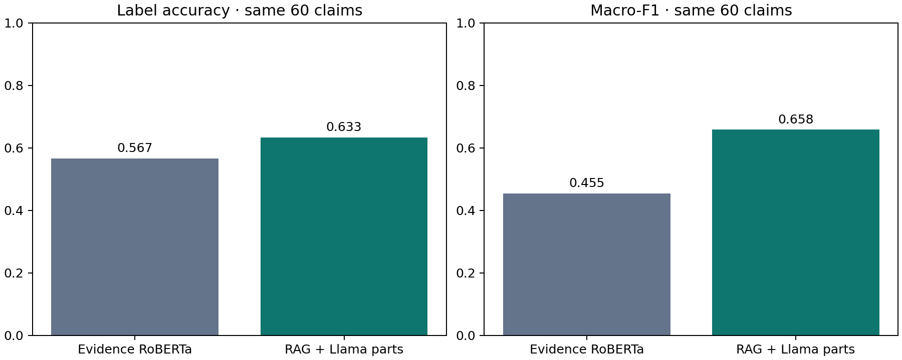
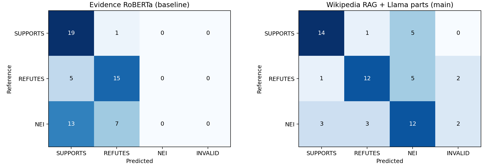

# Result Analysis: Wikipedia RAG with essential-part verdicts

## 1. Matched results

Both systems evaluated the same 60 fresh eligible internal test claims, balanced across the three FEVER labels. This is a small system comparison, not full test-partition performance.

| System | N | Accuracy | Macro-F1 | INVALID | Mean seconds |
|---|---:|---:|---:|---:|---:|
| Evidence RoBERTa (baseline) | 60 | 56.67% | 0.4548 | 0 | 0.14 |
| Wikipedia RAG + Llama parts (main) | 60 | 63.33% | 0.6583 | 4 | 58.76 |
| Llama's overall label (diagnostic) | 60 | 63.33% | 0.6544 | 4 | same call as main |

The main prediction is derived from the essential-part verdicts. The model-provided overall label is shown separately. Neither system receives reference labels. INVALID outputs remain incorrect and stay in the denominator.

## 2. Quantitative analysis

The net gain comes from NEI recognition: 12/20 correct versus 0/20 for the baseline. SUPPORTS recall fell from 19/20 to 14/20, and REFUTES recall fell from 15/20 to 12/20. Thus the method trades some support/refutation accuracy for better NEI coverage. The weak NEI baseline is consistent with its known training mismatch, but this comparison does not establish causation. The main model and its raw overall labels both achieved 38/60; code aggregation did not increase accuracy on this test sample.

The observed accuracy difference is +6.67 percentage points; macro-F1 difference is +0.2035. The paired claim-bootstrap 95% accuracy-difference interval is [-10.00, +21.67] percentage points. The interval includes zero, so a reliable accuracy gain is not established.

The main system corrected 14 baseline mistakes and introduced 10 new mistakes. Model/derived-label disagreements: 4.

| System | Label | Precision | Recall | F1 |
|---|---|---:|---:|---:|
| Evidence RoBERTa (baseline) | SUPPORTS | 0.514 | 0.950 | 0.667 |
| Evidence RoBERTa (baseline) | REFUTES | 0.652 | 0.750 | 0.698 |
| Evidence RoBERTa (baseline) | NOT ENOUGH INFO | 0.000 | 0.000 | 0.000 |
| Wikipedia RAG + Llama parts (main) | SUPPORTS | 0.778 | 0.700 | 0.737 |
| Wikipedia RAG + Llama parts (main) | REFUTES | 0.750 | 0.600 | 0.667 |
| Wikipedia RAG + Llama parts (main) | NOT ENOUGH INFO | 0.545 | 0.600 | 0.571 |
| Llama's overall label (diagnostic) | SUPPORTS | 0.778 | 0.700 | 0.737 |
| Llama's overall label (diagnostic) | REFUTES | 0.700 | 0.700 | 0.700 |
| Llama's overall label (diagnostic) | NOT ENOUGH INFO | 0.556 | 0.500 | 0.526 |

## 3. Qualitative evidence

Purposefully selected qualitative examples, inspected with AI assistance; no independently annotated failure-category rates or human validation study is claimed.

### Main correct, baseline wrong: appropriate NEI

**Claim 5941:** Saif Ali Khan worked in literature.

Reference: **NOT ENOUGH INFO**. Baseline: **SUPPORTS**. Main: **NOT ENOUGH INFO**.

FEVER labels this NEI. The supplied article mentions books, films and literature in Khan's family lineage; that does not establish that he personally worked in literature. The main model returned NEI rather than treating an association as proof. RoBERTa returned SUPPORTS.

Model justification: There is no mention of Saif Ali Khan working in literature in the provided passages.

Evidence E15, [Saif Ali Khan](https://en.wikipedia.org/w/index.php?title=Saif_Ali_Khan&oldid=1381321208):

> Does his real-life golden status—with literature, cinema, cricket and royalty in his lineage—make him exceptionally effective at coming across as spoiled?"

### Baseline correct, main wrong: inconsistent verdict

**Claim 45888:** Lil Wayne's sixth album came out in 2008.

Reference: **SUPPORTS**. Baseline: **SUPPORTS**. Main: **REFUTES**.

FEVER labels this SUPPORTS. The model's justification describes Tha Carter III as the sixth album released in 2008, yet its part verdict is REFUTES. E6 gives the year but does not itself establish the ordinal; no cited contradiction is offered. Deterministic aggregation faithfully propagates the wrong part verdict.

Model justification: E6 states that Tha Carter III was released in 2008, which is the sixth studio album by Lil Wayne.

Evidence E6, [Lil Wayne](https://en.wikipedia.org/w/index.php?title=Lil_Wayne&oldid=1380008783):

> Tha Carter III (2008)

### Both wrong: upstream evidence selection

**Claim 41404:** Greece has the 11th longest coastline.

Reference: **SUPPORTS**. Baseline: **REFUTES**. Main: **NOT ENOUGH INFO**.

FEVER labels this SUPPORTS. The selected pages were Coastline FM, Coastline paradox, Concordant coastline, Discordant coastline and Emergent coastline; the Greece article was absent. E2 is only a related-list title, not evidence of Greece's rank. The main model returned NEI on that context, while RoBERTa returned REFUTES. More full article text did not repair selection of the wrong pages.

Model justification: There is no evidence provided that directly supports or refutes the claim about Greece's coastline length.

Evidence E2, [Coastline paradox](https://en.wikipedia.org/w/index.php?title=Coastline_paradox&oldid=1377437344):

> List of countries by length of coastline

### Correct label, unsupported justification

A correct label is not necessarily a grounded decision. For the Supernatural season-ending claim, the main model matched the REFUTES reference but justified it by saying the passages did not mention the season or its end date. It cited all 36 excerpt IDs, mostly from the general supernatural-concepts article. Missing information does not justify REFUTES. This example shows why label accuracy and structurally valid citations cannot establish explanation faithfulness.

Full prompts and raw responses for all 60 claims remain in the trace viewer and the accompanying files.

## 4. Hypothesis

Partially supported. The main pipeline had higher observed accuracy (63.33% versus 56.67%) and macro-F1 (0.6583 versus 0.4548). However, the paired accuracy-difference interval spans -10.00 to +21.67 percentage points, so a reliable population accuracy gain is not established. Correct labels can still have unsupported explanations. The finding is limited to this balanced 60-claim study and this baseline.

## 5. Limitations and literature context

- 60-claim single-run balanced study, not full test-set performance.
- Selected prompt was developed on ten other inspected examples.
- Live Wikipedia versions differ from the historical FEVER evidence corpus.
- Baseline trained on annotated evidence with empty NEI inputs; no retraining.
- No strict FEVER score for live article block citations.
- Full article text and vectors are deleted; exact supplied prompts can be replayed.
- The balanced sample has different class proportions from the full test population.
- Context/output limits, one model/quantization, one execution, network failures and article date can affect outcomes.
- The whole pipeline differs: a gain/loss cannot be attributed solely to embeddings or the parts prompt.
- GEAR/KGAT published official-development or test scores concern different populations; their strict FEVER scores are not label accuracy. Their graph aggregation provides methodological context, not a matched numerical leaderboard here.
- The hybrid paper reports F1 on 1,000 sampled SUPPORTS/REFUTES claims with NEI excluded. FActScore measures supported atomic-fact precision. These are distinct evaluation setups.

Sources: [GEAR](https://aclanthology.org/P19-1085/), [KGAT Table 2](https://aclanthology.org/2020.acl-main.655.pdf), [hybrid paper](https://aclanthology.org/2025.winlp-main.19.pdf), [FActScore](https://aclanthology.org/2023.emnlp-main.741/).

Full protocols, immutable traces, per-class CSV and paired predictions accompany this report. The earlier inspected 7/10 development result is not pooled into this test result.

## Historical full-benchmark literature context

This separate table concerns all 19,998 official development claims, not our 60-claim main-model study. It matches population and metric definitions, but published architectures/training resources differ and the models were not rerun.

| System | Label accuracy | Strict FEVER |
|---|---:|---:|
| Historical evidence RoBERTa, 256 tokens | 52.37% | 35.07% |
| GEAR, published Dev reference | 74.84% | 70.69% |
| KGAT RoBERTa-large, published Dev reference | 78.29% | 76.11% |

Source: [KGAT Table 2, development columns](https://aclanthology.org/2020.acl-main.655.pdf). The workbook headline scores 67.10% and 70.38% are test FEVER scores. They are different columns, not replacements for development results. The new main model has no full-benchmark result.
