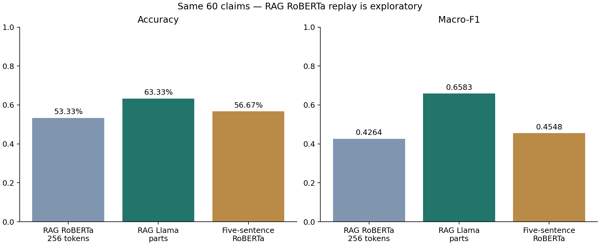
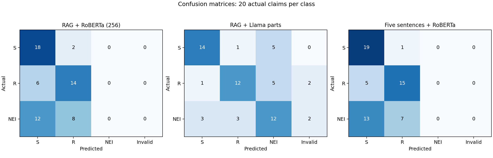

# Result Analysis

## 1. Results

I compared RAG + Llama with RAG + RoBERTa on the same 60 FEVER claims: 20 SUPPORTS, 20 REFUTES, and 20 NOT ENOUGH INFO (NEI). The original five-sentence RoBERTa is included as a reference.

| System | Correct | Accuracy | Macro-F1 |
|---|---:|---:|---:|
| RAG + RoBERTa, 256 tokens | 32/60 | 53.33% | 0.4264 |
| RAG + RoBERTa, 512 tokens | 32/60 | 53.33% | 0.4264 |
| RAG + Llama, claim-part verdicts | 38/60 | 63.33% | 0.6583 |
| Five-sentence RoBERTa, 256 tokens | 34/60 | 56.67% | 0.4548 |

Both RAG systems used the same saved passages. RoBERTa truncated them to its token limit; Llama received a larger context and returned a verdict for each essential part of the claim. Code combined those verdicts into the final label. RoBERTa was not retrained. Its RAG replay happened after the claims had been inspected, so that comparison is exploratory.

**Literature context.** KGAT reports 70.38% test FEVER score, which requires correct evidence as well as the label. Kolli et al. report F1 of 0.931 on 1,000 sampled SUPPORTS/REFUTES claims, excluding NEI. Neither number is directly comparable to our three-class accuracy on 60 claims. Their approaches inform the design, but our results do not establish competitive benchmark performance. [KGAT, Tables 1–2](https://aclanthology.org/2020.acl-main.655.pdf); [Kolli et al., Section 4 and Table 1](https://aclanthology.org/2025.winlp-main.19.pdf).

**Comparison using the same evaluation split and metrics.** A separate historical RoBERTa run evaluated all 19,998 official FEVER development claims. The published GEAR and KGAT development results below use the same population and metric definitions. The new RAG systems were not run on this full split.

| Official development result | Label accuracy | Strict FEVER score |
|---|---:|---:|
| Our historical five-sentence RoBERTa | 52.37% | 35.07% |
| GEAR, published | 74.84% | 70.69% |
| KGAT RoBERTa-large, published | 78.29% | 76.11% |

Our historical baseline was lower on both metrics. This is an external reference comparison, not a controlled reproduction: training data, model size, and retrieval differ. Its audit also found three normalized-text overlaps with our original training pool; they remained in the full development evaluation. Published values come from KGAT Table 2, development columns. They must not be mixed with the 60-claim RAG results.

## 2. What the numbers show

| System | Class | Precision | Recall | F1 |
|---|---|---:|---:|---:|
| RAG RoBERTa, 256 | SUPPORTS | 0.500 | 0.900 | 0.643 |
| RAG RoBERTa, 256 | REFUTES | 0.583 | 0.700 | 0.636 |
| RAG RoBERTa, 256 | NEI | 0.000* | 0.000 | 0.000 |
| RAG Llama | SUPPORTS | 0.778 | 0.700 | 0.737 |
| RAG Llama | REFUTES | 0.750 | 0.600 | 0.667 |
| RAG Llama | NEI | 0.545 | 0.600 | 0.571 |

*RoBERTa predicted no NEI labels; undefined precision is recorded as zero. The 512-token RAG condition had the same aggregate class metrics.

Llama correctly identified 12/20 NEI claims; RAG RoBERTa identified none. However, Llama correctly classified fewer supported claims (14 versus 18) and refuted claims (12 versus 14). Its advantage came from recognizing insufficient evidence, not from improving every class.

Llama fixed 15 RAG RoBERTa errors and introduced nine, gaining six correct answers overall. The exploratory paired-bootstrap 95% interval for the accuracy difference was −6.67 to +25.00 percentage points. This small sample does not establish a reliable general advantage. Four invalid Llama outputs were counted as incorrect.

[Full per-class TP, FP, FN, TN and metrics](per_class_counts.csv).

## 3. Examples from the saved traces

| Claim | FEVER label | RAG RoBERTa | RAG Llama | What happened |
|---|---|---|---|---|
| Saif Ali Khan worked in literature. | NEI | SUPPORTS | NEI | A passage mentions literature in his family lineage. That does not establish his own work in literature. |
| Lil Wayne’s sixth album came out in 2008. | SUPPORTS | SUPPORTS | REFUTES | Llama’s justification describes an album released in 2008, but its verdict says REFUTES. The explanation and label are inconsistent. |
| Greece has the 11th longest coastline. | SUPPORTS | REFUTES | NEI | Retrieval selected coastline-related pages but missed Greece. More text from the wrong pages did not supply the needed evidence. |

**Evidence and model output.** These are saved excerpts, not reconstructed explanations.

- **Saif Ali Khan, trace 5941:** E15 describes “literature, cinema, cricket and royalty in his lineage.” Llama returned NEI: “There is no mention of Saif Ali Khan working in literature in the provided passages.” The family association is insufficient to establish the personal-work claim. Source: Saif Ali Khan, Wikipedia revision 1381321208.
- **Lil Wayne, trace 45888:** E6 contains “Tha Carter III (2008).” Llama nevertheless returned REFUTES while saying: “E6 states that Tha Carter III was released in 2008, which is the sixth studio album by Lil Wayne.” E6 supports the year but does not itself establish the ordinal; the response supplies no cited contradiction. Source: Lil Wayne, Wikipedia revision 1380008783.
- **Greece, trace 41404:** E2 contains “List of countries by length of coastline,” not Greece’s rank. Llama returned NEI. The selected articles included Coastline FM and Coastline paradox, rather than Greece. That supports an upstream retrieval-failure diagnosis, not proof that the classifier would fail with the right evidence. Source: Coastline paradox, Wikipedia revision 1377437344.

These examples show three different issues: insufficient evidence, a classification inconsistency, and failed page selection. They are illustrative cases, not independently annotated error rates.

Explore all 60 claims, exact prompts, unedited responses, evidence and model inputs in the public dashboard:

[https://fever-research-results-praise.praise-ben.chatgpt.site](https://fever-research-results-praise.praise-ben.chatgpt.site)

Example traces: [Saif Ali Khan](https://fever-research-results-praise.praise-ben.chatgpt.site/#5941), [Lil Wayne](https://fever-research-results-praise.praise-ben.chatgpt.site/#45888), [Greece](https://fever-research-results-praise.praise-ben.chatgpt.site/#41404). The dashboard shows one claim at a time, comparing RAG RoBERTa (256 tokens) with Llama. Full debug details retain the 512-token RAG condition and original five-sentence reference. It displays saved results and runs no new inference.

## 4. Hypotheses and the symbolic experiment

The symbolic stage was tested separately on 100 different claims. Retrieval + RoBERTa and symbolic-first both scored **71/100**. Symbolic verification avoided one neural call, but mean time increased from **0.104 to 0.207 seconds per claim**.

| Symbolic outcome | Claims |
|---|---:|
| Wording did not match the parser | 96 |
| Lookup request failed | 2 |
| Insufficient usable structured evidence | 1 |
| Verified successfully | 1 |

The main bottleneck was our parser: most claims never reached knowledge lookup. It also misread “the seventies” as a place expression. The one successful check matched Oh Yeon-seo’s birth year to Wikidata, but RoBERTa already answered it correctly. The database stored external Wikidata statements, not facts inferred as true from the claims.

The hybrid literature system links entities, retrieves and ranks related facts, then supplies them to a model. Our symbolic stage used narrow wording rules and value comparisons. Its failure does not establish that the broader approach cannot help.

| Original hypothesis | Finding |
|---|---|
| H1: Higher/comparable accuracy with lower latency from the symbolic hybrid. | **Not supported here:** unchanged accuracy and higher latency. The separate Llama RAG result does not test this combined architecture. |
| H2: LLM judges are less reliable or consistent than supervised classifiers. | **The predicted accuracy direction was not observed:** Llama scored higher on these 60 claims. Consistency was not tested through repeated runs. |
| H3: Symbolic verification reduces neural work and improves efficiency. | **One call was saved, but overall latency worsened.** The full efficiency claim was not supported. |

## 5. Limitations

The main study used 60 claims. At the measured Llama pipeline average of 58.76 seconds per claim, our 13,448 eligible internal test claims would take roughly **9.1 continuous days**. A hypothetical 120,000-claim run would take about **81.6 days** at that rate. These are serial runtime estimates, not completed runs.

Training and evaluation sizes must be distinguished: KGAT lists 145,449 training claims and 19,998 claims in each evaluation split; the hybrid paper sampled 1,000 evaluation claims. Our 60-claim result is not a full-benchmark result.

Other limits are important: one run per claim; prompt selection on a separate ten-claim development sample; a retrospective RoBERTa RAG replay; different effective context budgets; and current Wikipedia evidence rather than FEVER’s historical snapshot. All RAG RoBERTa inputs exceeded 256 tokens, and 56/60 exceeded 512. Its original training also used empty evidence for NEI claims, weakening that baseline.

The study did not independently validate explanations, test corpus-growth scalability, or measure end-to-end RAG RoBERTa latency. Symbolic request failures and narrow rules further limit the conclusions. No full-test accuracy, general knowledge-graph benefit, or efficiency improvement is claimed.

## Sources and reproducibility

Figures and counts are calculated from saved predictions. Main-study sources: `parts_test60_20261030_v2/summary.json` and per-claim traces. RAG RoBERTa: `roberta_rag_replay60_20261030/summary.json` and replay traces. Symbolic study: `symbolic_v3_rq3_20261030_v2/summary.json` and stored Wikidata snapshots. Historical development result: `official_fever_dev_20261023/summary.json`. All are preserved under `reports/part2/`.

Literature: Zhou et al. (2019), GEAR; Liu et al. (2020), KGAT, Tables 1–2; Kolli et al. (2025), Hybrid Fact-Checking, Section 4 and Table 1. Original H1–H3 are from the project proposal. The main study used a prompt selected on ten separate development claims; no test-result-driven retraining was performed. The exploratory replay and later change in which baseline is foregrounded are disclosed above.
