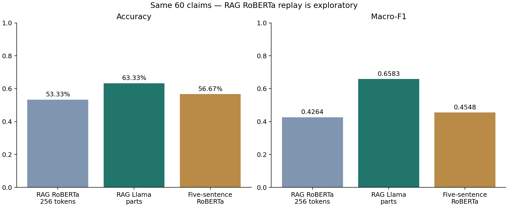
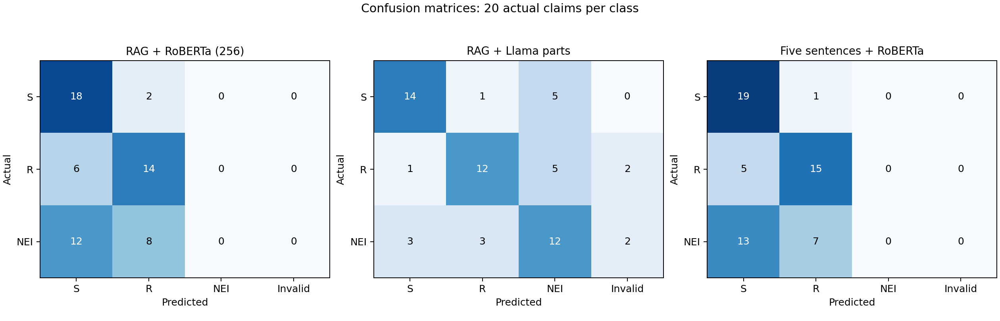

# Result Analysis
## Evidence retrieval, Llama verification, and a symbolic-stage experiment on FEVER

This study evaluates whether a Wikipedia RAG pipeline with claim-part verdicts improves fact verification over an evidence-based RoBERTa baseline. A separate experiment examines whether an early symbolic knowledge-base stage improves RoBERTa accuracy or reduces inference work. These are two distinct experiments; their percentages are not pooled.

## 1. Organize and compare the results

### Main comparison: the same 60 claims

Both systems evaluated the same 60 eligible, previously unused internal test claims: 20 SUPPORTS, 20 REFUTES, and 20 NOT ENOUGH INFO (NEI). The prompt had previously been selected using a different, inspected ten-claim development sample. Reference labels were withheld from both systems during inference.

The baseline retrieves five Wikipedia evidence sentences and classifies the claim/evidence pair with a frozen RoBERTa checkpoint, using a 256-token input budget. The main system selects Wikipedia articles, fetches their contents, chunks and embeds the text in a temporary per-claim vector store, retrieves passages, and supplies those passages with the claim to local Llama 3.1 8B. Llama evaluates essential claim parts; code derives REFUTES if any part is refuted, SUPPORTS if all are supported, and NEI otherwise. Invalid responses are counted as incorrect. The main system receives selected passages, not every article chunk.

| System | Correct / total | Accuracy | Macro-F1 | Invalid outputs | Mean time / claim |
|---|---:|---:|---:|---:|---:|
| Evidence RoBERTa — baseline | 34/60 | 56.67% | 0.4548 | 0 | 0.14 s |
| Wikipedia RAG + Llama part verdicts — main | 38/60 | 63.33% | 0.6583 | 4 | 58.76 s |

The main system answered four more claims correctly, but required substantially more time. This is a comparison of complete pipelines: model, evidence source, retrieval, and input budgets differ. It does not isolate the effect of RAG or of the prompt alone.

### Relation to the literature review

The new main model has no full-benchmark result. Published results therefore provide context rather than a direct ranking against its 63.33% accuracy.

| Literature result | What was measured | How it relates to this study |
|---|---|---|
| GEAR: 67.10% | Published FEVER **test FEVER score**, requiring label and evidence correctness | Evidence-graph reasoning is relevant, but this is not the same metric or evaluation population as our 60-claim label accuracy. |
| KGAT: 70.38% | Published FEVER **test FEVER score** | Uses graph attention over evidence; our system retrieves passages and uses an LLM. Its headline score cannot be subtracted from our accuracy. |
| Kolli et al. hybrid pipeline: F1 0.931 | 1,000 sampled FEVER claims, SUPPORTS/REFUTES only; NEI excluded | Closest architectural comparison: entity linking, DBpedia fact retrieval/ranking, model classification, then web fallback. Our symbolic stage uses much narrower handwritten rules. Its F1 is not three-class accuracy. |

A separate historical baseline run permits a closer dataset/metric comparison. The following results concern the official 19,998-claim FEVER development set, **not the new 60-claim main-model experiment**. Published systems were not rerun, and their training resources and architectures differ.

| System | Development label accuracy | Development strict FEVER score |
|---|---:|---:|
| Historical evidence RoBERTa, 256 tokens | 52.37% | 35.07% |
| GEAR, published development reference | 74.84% | 70.69% |
| KGAT RoBERTa-large, published development reference | 78.29% | 76.11% |

The development reference numbers come from KGAT Table 2. They show that our historical evidence baseline remains below those published systems on both reported metrics; they do not measure our new main model.

## 2. Quantitative analysis

### Performance by class

| System | Class | Precision | Recall | F1 | Correct / class total |
|---|---|---:|---:|---:|---:|
| RoBERTa | SUPPORTS | 0.514 | 0.950 | 0.667 | 19/20 |
| RoBERTa | REFUTES | 0.652 | 0.750 | 0.698 | 15/20 |
| RoBERTa | NEI | 0.000* | 0.000 | 0.000 | 0/20 |
| RAG + Llama | SUPPORTS | 0.778 | 0.700 | 0.737 | 14/20 |
| RAG + Llama | REFUTES | 0.750 | 0.600 | 0.667 | 12/20 |
| RAG + Llama | NEI | 0.545 | 0.600 | 0.571 | 12/20 |

*RoBERTa predicted no NEI labels. Its undefined NEI precision is reported as zero by the scoring convention.

The main difference is NEI recognition: the main system correctly identified 12 of 20 NEI claims, while RoBERTa identified none. However, the main system correctly classified fewer SUPPORTS and REFUTES claims. Its SUPPORTS precision rose while recall fell: it made fewer false support predictions, but missed more supported claims. The baseline's NEI weakness should be interpreted alongside its training mismatch: NEI training inputs had empty evidence, unlike retrieved evidence at evaluation.

The main system fixed 14 baseline errors and introduced 10 errors on claims the baseline answered correctly. Its net accuracy difference was +6.67 percentage points. A paired claim-bootstrap 95% interval was −10.00 to +21.67 percentage points, which includes zero. A reliable population accuracy advantage is therefore not established. Four main-model responses were invalid after hitting the output limit; all four remain in the denominator. Code-derived and model-provided overall labels disagreed on four claims, but both achieved 38/60, so aggregation did not improve accuracy on this sample.

### Separate symbolic experiment: the same 100 claims within this experiment

A fresh, different sample of 100 claims contained 54 SUPPORTS, 25 REFUTES, and 21 NEI. It had no overlap with the main 60-claim sample.

| Condition | Correct / total | Accuracy | Macro-F1 | Neural calls | Mean time / claim |
|---|---:|---:|---:|---:|---:|
| Claim-only RoBERTa | 71/100 | 71.00% | 0.6320 | 100 | 0.059 s |
| Retrieval + RoBERTa | 71/100 | 71.00% | 0.5158 | 100 | 0.104 s |
| Symbolic stage → retrieval + RoBERTa fallback | 71/100 | 71.00% | 0.5158 | 99 | 0.207 s |

Symbolic-first predictions were identical to retrieval + RoBERTa on all 100 claims. The parser accepted only four claims; 96 did not match its grammar. Of the four accepted claims, two had operational lookup failures, one lacked sufficient evidence under the rules, and one was resolved correctly. Thus, one neural call was avoided, but accuracy did not improve and average time increased. Live network calls and shared caches limit precise efficiency comparisons. The 71% and 56.67% RoBERTa results come from different samples and are not evidence of an improvement between runs.

## 3. Qualitative analysis and debug traces

These examples were selected to illustrate different outcomes, not to estimate the frequency of each failure type. Inspection used AI assistance; no independent human review or explanation-faithfulness evaluation is claimed.

| Claim / trace ID | Reference | Baseline | Main | What the saved evidence and response show |
|---|---|---|---|---|
| “Saif Ali Khan worked in literature.” — 5941 | NEI | SUPPORTS | NEI | A passage mentions literature in his family lineage, which does not establish his own work in literature. The main response says the supplied passages do not establish the claim. |
| “Lil Wayne's sixth album came out in 2008.” — 45888 | SUPPORTS | SUPPORTS | REFUTES | The main model's justification describes a sixth album released in 2008, yet assigns REFUTES. Its cited E6 gives the year but does not itself establish the ordinal or a contradiction. This is a verdict/justification inconsistency. |
| “Greece has the 11th longest coastline.” — 41404 | SUPPORTS | REFUTES | NEI | Selected pages concerned coastline concepts and a radio station; Greece was absent. Reading more text from these pages could not repair the upstream page-selection failure. |

The Saif Ali Khan trace illustrates a useful distinction between related information and sufficient evidence. Llama returned:

> There is no mention of Saif Ali Khan working in literature in the provided passages.

The Lil Wayne trace illustrates the opposite: plausible-looking reasoning can accompany an incorrect label. Deterministic aggregation cannot repair an incorrect part verdict. Another inspected case, trace 24573 about Supernatural, matched the REFUTES reference but justified it using missing information. A correct label alone therefore does not demonstrate sound reasoning or relevant citations.

In the symbolic study, “Oh Yeon-seo was born in 1987” was checked against a saved Wikidata P569 value of June 22, 1987. The symbolic verdict was correct, but retrieval + RoBERTa was already correct. The parser also misrouted “the seventies” as a place expression, exposing an additional code limitation. The stored Wikidata statements were retrieved external assertions, not facts established by the input claims.

Saved trace viewer, while the local server is running:

- [Main correct / baseline wrong: 5941](http://127.0.0.1:8766/#5941)
- [Baseline correct / main wrong: 45888](http://127.0.0.1:8766/#45888)
- [Both wrong: 41404](http://127.0.0.1:8766/#41404)
- [Symbolic database and saved claim traces](http://127.0.0.1:8767/)

Each main-model trace retains the exact prompt, unedited response, selected passages, source revisions, part verdicts, final derived label, and baseline inputs. Localhost links are supplementary inspection tools; the written findings above remain understandable without them.

## 4. Revisit the original hypotheses

The original proposal predicted both better verification and greater efficiency. The later RAG main model and narrow symbolic verifier must be assessed separately rather than presented as a single completed version of that proposal.

| Original hypothesis | Assessment from these experiments |
|---|---|
| **H1:** Combining symbolic verification, retrieval, and Transformer classification achieves higher/comparable performance while reducing average latency. | **Not supported by the evaluated symbolic implementation.** Accuracy stayed at 71/100 and mean time increased from 0.104 to 0.207 seconds. The separate RAG model had higher observed accuracy on 60 claims but was slower and did not include this symbolic stage. It therefore does not establish H1. |
| **H2:** LLM judges are less reliable and/or consistent than supervised Transformer classifiers. | **The predicted accuracy direction was not observed in the 60-claim comparison:** Llama RAG scored 38/60 versus 34/60. The pipelines differ and the interval includes zero, so this does not establish general superiority. **Consistency remains untested in this single-run comparison.** |
| **H3:** An early symbolic stage reduces expensive retrieval/Transformer calls and improves overall efficiency. | **Only the call-reduction component was observed:** 99 rather than 100 neural calls. Overall efficiency was not improved under the measured latency metric, so H3 as a whole is **not supported here**. |

For the narrower question motivating the main experiment, RAG + Llama achieved higher observed accuracy and macro-F1, principally through better NEI recognition, with substantial latency cost and unresolved uncertainty about generalization.

Original RQ1, FEVER's representativeness of modern LLM errors, is outside this submission's evaluated scope. RQ2 receives a limited benchmark-accuracy assessment, not a new human-review or consistency study. RQ3 receives a negative result for a limited symbolic implementation. RQ4's corpus-growth scalability component remains untested; timing at one corpus setting cannot answer it.

## 5. Limitations

- The main study used 60 balanced claims and one inference per claim. It does not estimate full-test performance or prediction stability. The separate 100-claim sample has different class proportions.
- The prompt was developed on ten inspected examples. The evaluated samples should not be used for further tuning and then reported as fresh tests.
- The main and baseline pipelines differ in several components; their difference cannot be attributed to one architectural choice.
- RoBERTa's evidence-training mismatch, especially empty NEI evidence, weakens this baseline and limits broad conclusions about Transformer classifiers.
- Current Wikipedia and Wikidata may differ from FEVER's historical sources. FEVER reference labels were retained, including potentially disputable cases.
- Four Llama outputs were invalid. Context/output budgets, quantization, retrieval failures, and network failures constrain performance. Correct labels and valid citation IDs do not establish faithful explanations.
- Symbolic coverage was severely limited by handwritten parsing rules. Two lookups failed operationally; those failures do not show that facts were absent. The experiment does not reproduce the broader entity-linking, fact-ranking, and neural reasoning methods in the literature.
- Mean times exclude setup and are affected by caching and local/network conditions. No corpus-scaling study, energy measurement, or monetary-cost evaluation was completed here.
- Live article-block citations were not scored with strict FEVER evidence matching. Published strict FEVER scores, binary F1, and our three-class label accuracy are different measures.

The measured contribution is an inspectable comparison showing better NEI recognition, several reasoning and retrieval failures, and no accuracy or overall latency benefit from the current narrow symbolic stage. These findings identify concrete implementation limits without claiming an unmeasured improvement.

## References

1. Original project proposal: `Praise_DeepLearning2.pdf`, research questions and hypotheses.
2. Zhou et al. (2019), [GEAR](https://aclanthology.org/P19-1085/).
3. Liu et al. (2020), [KGAT](https://aclanthology.org/2020.acl-main.655.pdf), Table 2.
4. Kolli et al. (2025), [Hybrid Fact-Checking](https://aclanthology.org/2025.winlp-main.19.pdf), methodology and Table 1.

Measured results: `reports/part2/parts_test60_20261030_v2/summary.json`, saved per-class metrics, traces and qualitative review; `reports/part2/symbolic_v3_rq3_20261030_v2/summary.json`; historical official-development baseline summary. Original experiment outputs are preserved.
