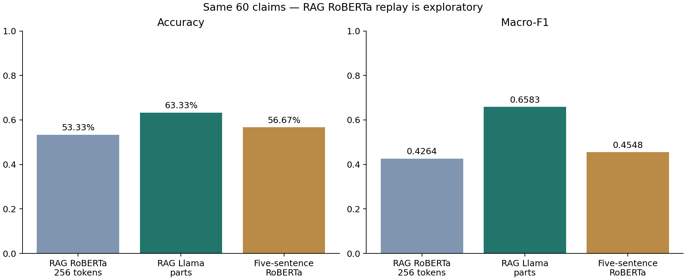
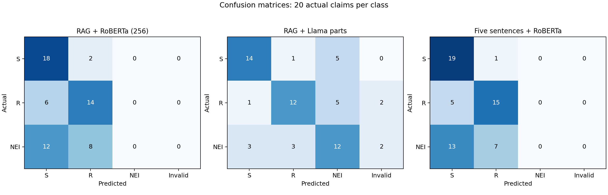

# Result Analysis
## Evidence retrieval, Llama verification, and a symbolic-stage experiment on FEVER

This study evaluates whether a Wikipedia RAG pipeline with claim-part verdicts improves fact verification over an evidence-based RoBERTa baseline. A separate experiment examines whether an early symbolic knowledge-base stage improves RoBERTa accuracy or reduces inference work. These are two distinct experiments; their percentages are not pooled.

## 1. Organize and compare the results

### Main comparison: the same 60 claims

The report foregrounds the requested **RAG + RoBERTa versus RAG + Llama** comparison. The original five-sentence RoBERTa remains a reference condition. This change in presentation is retrospective: the RoBERTa RAG replay took place after inspection of the 60 claims and is **exploratory**, not a newly frozen confirmatory study.

Both RAG classifiers received evidence drawn from the same saved passages in the same order. This controls evidence retrieval better than the original comparison, but does not give identical effective context: RoBERTa retained at most 256 or 512 tokens, while Llama used a different tokenizer and larger prompt budget. RoBERTa was not retrained on RAG evidence. None of these conditions reads every database chunk.

Both systems evaluated the same 60 eligible, previously unused internal test claims: 20 SUPPORTS, 20 REFUTES, and 20 NOT ENOUGH INFO (NEI). The prompt had previously been selected using a different, inspected ten-claim development sample. Reference labels were withheld from both systems during inference.

The RAG RoBERTa baseline concatenates the saved retrieved passages and classifies the claim/evidence pair with a frozen checkpoint. Its original training is unchanged. The main system retrieves Wikipedia articles, chunks and embeds their contents in a temporary per-claim vector store, retrieves passages, and supplies them to local Llama 3.1 8B. Llama returns essential-part verdicts; code derives REFUTES if any part is refuted, SUPPORTS if all are supported, and NEI otherwise. Invalid responses count as incorrect.

| Condition on the same 60 claims | Correct | Accuracy | Macro-F1 | Invalid | Truncated RoBERTa inputs |
|---|---:|---:|---:|---:|---:|
| RAG + RoBERTa, 256 tokens — comparison baseline | 32/60 | 53.33% | 0.4264 | 0 | 60/60 |
| RAG + RoBERTa, 512 tokens — length variant | 32/60 | 53.33% | 0.4264 | 0 | 56/60 |
| RAG + Llama part verdicts — main | 38/60 | 63.33% | 0.6583 | 4 | Not comparable across tokenizers |
| Original five sentences + RoBERTa, 256 tokens — reference | 34/60 | 56.67% | 0.4548 | 0 | 2/60 |
| Original five sentences + RoBERTa, 512 tokens — reference variant | 34/60 | 56.67% | 0.4548 | 0 | 0/60 |

The main model answered six more claims correctly than RAG RoBERTa, and four more than the original five-sentence reference. Giving the frozen RoBERTa more RAG evidence did not improve its accuracy. At 512 tokens, two predictions improved and two worsened compared with RAG at 256, leaving its score unchanged. Matching headline scores does not imply identical predictions.

Mean end-to-end measured time was 58.76 seconds for RAG + Llama and 0.14 seconds for the original five-sentence reference, excluding setup. RoBERTa RAG replay measured classifier inference only, reusing previously fetched and embedded evidence. It is therefore not an end-to-end RAG timing comparison; we do not assign that pipeline a falsely low total runtime.

### Why 60 claims, and what the larger dataset numbers mean

The 60 claims were a practical sample chosen to fit the approved 3–4 hour project window, not the full FEVER test set and not the entire dataset. Our internal test partition contained 14,548 rows; the earlier audit identified 13,448 eligible unique claims after exclusions. This internal split differs from the official benchmark split used in published work.

FEVER's official release contains 185,445 claims. KGAT Table 1 lists **145,449 training claims** and **19,998 development and 19,998 test claims**. Training size is not the number of examples behind an evaluation percentage. The hybrid paper by Kolli et al. evaluated **1,000 sampled SUPPORTS/REFUTES claims**, excluding NEI; it did not report its headline F1 on every FEVER claim. We should not describe all literature results as evaluations of “120,000 claims.”

At the measured RAG + Llama mean of 58.76 seconds per claim, a simple serial extrapolation to 13,448 eligible claims is about **219.5 hours (9.1 continuous days)**. Hypothetically, 120,000 claims would take about **1,958.6 hours (81.6 days)** at that same rate. These are rough projections, not completed runs or promised runtimes; caching, article lengths, network behavior, and hardware can change them. They estimate this pipeline's inference time, not RoBERTa training time. The earlier pilot-based plan estimated about 8.4 days for 13,448 claims; the estimate here uses the completed 60-claim mean instead.

Sources: [official FEVER dataset](https://fever.ai/dataset/fever.html), [KGAT Tables 1–2](https://aclanthology.org/2020.acl-main.655.pdf), and [hybrid paper, Section 4](https://aclanthology.org/2025.winlp-main.19.pdf).

### Relation to the literature review

The new main model has no full-benchmark result. Published results therefore provide context rather than a direct ranking against its 63.33% accuracy.

| Literature result | What was measured | How it relates to this study |
|---|---|---|
| GEAR: 67.10% | Published FEVER **test FEVER score**, requiring label and evidence correctness | Evidence-graph reasoning is relevant, but this is not the same metric or evaluation population as our 60-claim label accuracy. |
| KGAT: 70.38% | Published FEVER **test FEVER score** | Uses graph attention over evidence; our system retrieves passages and uses an LLM. Its headline score cannot be subtracted from our accuracy. |
| Kolli et al. hybrid pipeline: F1 0.931 | 1,000 sampled FEVER claims, SUPPORTS/REFUTES only; NEI excluded | Closest architectural comparison: entity linking, DBpedia fact retrieval/ranking, model classification, then web fallback. Our symbolic stage uses much narrower handwritten rules. Its F1 is not three-class accuracy. |

A separate historical baseline run permits a closer dataset/metric comparison. The following results concern the official 19,998-claim FEVER development set, **not the new 60-claim main-model experiment**. Published systems were not rerun, and their training resources and architectures differ.

| System | Development label accuracy | Development strict FEVER score |
|---|---:|---:|
| Historical evidence RoBERTa, 256 tokens | 52.37% | 35.07% |
| GEAR, published development reference | 74.84% | 70.69% |
| KGAT RoBERTa-large, published development reference | 78.29% | 76.11% |

The development reference numbers come from KGAT Table 2. They show that our historical evidence baseline remains below those published systems on both reported metrics; they do not measure our new main model.

## 2. Quantitative analysis

### Performance by class

Precision asks: when the system predicts a class, how often is it correct? Recall asks: of the claims belonging to that class, how many did it find? F1 balances both. Macro-F1 averages the three class F1 scores equally.

| System | Class | Precision | Recall | F1 | Correct / class total |
|---|---|---:|---:|---:|---:|
| RAG + RoBERTa (256) | SUPPORTS | 0.500 | 0.900 | 0.643 | 18/20 |
| RAG + RoBERTa (256) | REFUTES | 0.583 | 0.700 | 0.636 | 14/20 |
| RAG + RoBERTa (256) | NOT ENOUGH INFO | 0.000 | 0.000 | 0.000 | 0/20 |
| RAG + Llama parts | SUPPORTS | 0.778 | 0.700 | 0.737 | 14/20 |
| RAG + Llama parts | REFUTES | 0.750 | 0.600 | 0.667 | 12/20 |
| RAG + Llama parts | NOT ENOUGH INFO | 0.545 | 0.600 | 0.571 | 12/20 |
| Five sentences + RoBERTa | SUPPORTS | 0.514 | 0.950 | 0.667 | 19/20 |
| Five sentences + RoBERTa | REFUTES | 0.652 | 0.750 | 0.698 | 15/20 |
| Five sentences + RoBERTa | NOT ENOUGH INFO | 0.000 | 0.000 | 0.000 | 0/20 |

Neither RoBERTa evidence condition predicted NEI. Its undefined NEI precision is represented as zero by the scoring convention. The main model found 12/20 NEI claims, but correctly classified fewer SUPPORTS and REFUTES claims than either RoBERTa condition. The improvement in overall accuracy therefore reflects a trade-off, not better performance on every class. The known empty-evidence NEI training mismatch is a plausible contributor to RoBERTa's NEI weakness, not a proven causal explanation.

Rows below are actual FEVER labels; columns are predictions. INVALID remains an error, not a fourth ground-truth class.

**RAG + RoBERTa (256)**

| Actual \ Predicted | SUPPORTS | REFUTES | NEI | INVALID |
|---|---:|---:|---:|---:|
| SUPPORTS | 18 | 2 | 0 | 0 |
| REFUTES | 6 | 14 | 0 | 0 |
| NEI | 12 | 8 | 0 | 0 |

**RAG + Llama parts**

| Actual \ Predicted | SUPPORTS | REFUTES | NEI | INVALID |
|---|---:|---:|---:|---:|
| SUPPORTS | 14 | 1 | 5 | 0 |
| REFUTES | 1 | 12 | 5 | 2 |
| NEI | 3 | 3 | 12 | 2 |

**Five sentences + RoBERTa**

| Actual \ Predicted | SUPPORTS | REFUTES | NEI | INVALID |
|---|---:|---:|---:|---:|
| SUPPORTS | 19 | 1 | 0 | 0 |
| REFUTES | 5 | 15 | 0 | 0 |
| NEI | 13 | 7 | 0 | 0 |

Because this is a three-class task, TP/FP/FN/TN are calculated separately for each class, treating that class as positive and all others as negative.

| System | Positive class | TP | FP | FN | TN |
|---|---|---:|---:|---:|---:|
| RAG + RoBERTa (256) | SUPPORTS | 18 | 18 | 2 | 22 |
| RAG + RoBERTa (256) | REFUTES | 14 | 10 | 6 | 30 |
| RAG + RoBERTa (256) | NOT ENOUGH INFO | 0 | 0 | 20 | 40 |
| RAG + Llama parts | SUPPORTS | 14 | 4 | 6 | 36 |
| RAG + Llama parts | REFUTES | 12 | 4 | 8 | 36 |
| RAG + Llama parts | NOT ENOUGH INFO | 12 | 10 | 8 | 30 |
| Five sentences + RoBERTa | SUPPORTS | 19 | 18 | 1 | 22 |
| Five sentences + RoBERTa | REFUTES | 15 | 8 | 5 | 32 |
| Five sentences + RoBERTa | NOT ENOUGH INFO | 0 | 0 | 20 | 40 |

Against RAG RoBERTa at 256 tokens, Llama fixed **15** errors and introduced **9**, for a net **+10.00 percentage points**. An exploratory paired bootstrap (10,000 resamples, seed 42) gives a 95% percentile interval of **-6.67 to +25.00 percentage points**. This resamples the 60 claims; it does not measure run-to-run variation or remove retrospective-selection bias. Against the original five-sentence reference, Llama fixed 14 and introduced 10; the earlier paired interval was −10.00 to +21.67 percentage points. Neither interval establishes a reliable population accuracy advantage.

Four Llama responses hit the output cap and were invalid. Model-provided and code-derived labels disagreed on four claims, but both scored 38/60; aggregation did not improve accuracy on this sample.

### Separate symbolic experiment: the same 100 claims within this experiment

A fresh, different sample of 100 claims contained 54 SUPPORTS, 25 REFUTES, and 21 NEI. It had no overlap with the main 60-claim sample.

| Condition | Correct / total | Accuracy | Macro-F1 | Neural calls | Mean time / claim |
|---|---:|---:|---:|---:|---:|
| Claim-only RoBERTa | 71/100 | 71.00% | 0.6320 | 100 | 0.059 s |
| Retrieval + RoBERTa | 71/100 | 71.00% | 0.5158 | 100 | 0.104 s |
| Symbolic stage → retrieval + RoBERTa fallback | 71/100 | 71.00% | 0.5158 | 99 | 0.207 s |

Symbolic-first predictions were identical to retrieval + RoBERTa on all 100 claims. The parser accepted only four claims; 96 did not match its grammar. Of the four accepted claims, two had operational lookup failures, one lacked sufficient evidence under the rules, and one was resolved correctly. Thus, one neural call was avoided, but accuracy did not improve and average time increased. Live network calls and shared caches limit precise efficiency comparisons. The 71% and 56.67% RoBERTa results come from different samples and are not evidence of an improvement between runs.

### Why the symbolic stage did not help

The 293 stored statements are a local record of externally retrieved Wikidata assertions, including identifiers and metadata. They are not 293 claims verified, and they were not generated as true facts from the input claims.

| Observed issue | Evidence from this run | Interpretation |
|---|---|---|
| Narrow claim parser | 96/100 claims rejected before lookup | The dominant measured bottleneck. A useful fact may exist but is never requested. |
| Operational failures | Two accepted claim lookup chains failed | These are service/request failures, not evidence that Wikidata lacked facts; the saved generic error does not establish a more specific cause. |
| Conservative comparison | One accepted claim lacked sufficient evidence under the rules | Qualified, ambiguous, missing, or insufficiently precise facts can trigger abstention; guessing would not be a valid repair. |
| Parser defect | “The seventies” was routed toward a place lookup | An implementation bug, not a limitation of symbolic knowledge in principle. |
| Limited opportunity for gains | The one resolved claim was already correct under RoBERTa | One avoided neural call, zero baseline errors repaired. |
| Network overhead | Mean time increased from 0.104 to 0.207 seconds | Lookups outweighed the saving from one avoided call in this measured setting. |

The literature's hybrid pipeline links entities broadly, retrieves one-hop DBpedia triples, ranks them semantically, and gives selected facts to an LLM or DeBERTa before web fallback. Our implementation requires a few wording patterns and uses handwritten value comparisons. It does not reproduce that reasoning architecture. The measured failure is therefore **low coverage and no benefit from this particular implementation**, not a demonstration that knowledge graphs cannot improve fact-checking. Broader entity linking, fact ranking, and model-based evidence comparison are plausible next experiments, not measured fixes in this report.

## 3. Qualitative analysis and debug traces

These examples were selected to illustrate different outcomes, not to estimate the frequency of each failure type. Inspection used AI assistance; no independent human review or explanation-faithfulness evaluation is claimed.

| Claim / trace ID | Reference | Five-sentence RoBERTa | RAG RoBERTa, 256 | Main | What the saved evidence and response show |
|---|---|---|---|---|---|
| “Saif Ali Khan worked in literature.” — 5941 | NEI | SUPPORTS | SUPPORTS | NEI | A passage mentions literature in his family lineage, which does not establish his own work in literature. The main response says the supplied passages do not establish the claim. |
| “Lil Wayne's sixth album came out in 2008.” — 45888 | SUPPORTS | SUPPORTS | SUPPORTS | REFUTES | The main model's justification describes a sixth album released in 2008, yet assigns REFUTES. Its cited E6 gives the year but does not itself establish the ordinal or a contradiction. This is a verdict/justification inconsistency. |
| “Greece has the 11th longest coastline.” — 41404 | SUPPORTS | REFUTES | REFUTES | NEI | Selected pages concerned coastline concepts and a radio station; Greece was absent. Reading more text from these pages could not repair the upstream page-selection failure. |

The Saif Ali Khan trace illustrates a useful distinction between related information and sufficient evidence. Llama returned:

> There is no mention of Saif Ali Khan working in literature in the provided passages.

The Lil Wayne trace illustrates the opposite: plausible-looking reasoning can accompany an incorrect label. Deterministic aggregation cannot repair an incorrect part verdict. Another inspected case, trace 24573 about Supernatural, matched the REFUTES reference but justified it using missing information. A correct label alone therefore does not demonstrate sound reasoning or relevant citations.

In the symbolic study, “Oh Yeon-seo was born in 1987” was checked against a saved Wikidata P569 value of June 22, 1987. The symbolic verdict was correct, but retrieval + RoBERTa was already correct. The parser also misrouted “the seventies” as a place expression, exposing an additional code limitation. The stored Wikidata statements were retrieved external assertions, not facts established by the input claims.

Saved trace viewer, while the local server is running:

- [Main correct / baseline wrong: 5941](http://127.0.0.1:8766/#5941)
- [Baseline correct / main wrong: 45888](http://127.0.0.1:8766/#45888)
- [Both wrong: 41404](http://127.0.0.1:8766/#41404)
- [Symbolic database and saved claim traces](http://127.0.0.1:8767/)

The existing web viewer displays Llama and the original five-sentence RoBERTa trace. The RAG RoBERTa traces are separate and are linked below; they must not be mistaken for the five-sentence traces. Each RAG RoBERTa trace includes its evidence text, retained token input, truncation details, logits, probabilities, and prediction. Each main-model trace retains the exact prompt, unedited response, selected passages, source revisions, part verdicts, and final derived label. Localhost links are supplementary inspection tools; the written findings above remain understandable without them.

- [RAG RoBERTa trace: 5941](rag_roberta_traces/5941.json)
- [RAG RoBERTa trace: 45888](rag_roberta_traces/45888.json)
- [RAG RoBERTa trace: 41404](rag_roberta_traces/41404.json)

## 4. Revisit the original hypotheses

The original proposal predicted both better verification and greater efficiency. The later RAG main model and narrow symbolic verifier must be assessed separately rather than presented as a single completed version of that proposal.

| Original hypothesis | Assessment from these experiments |
|---|---|
| **H1:** Combining symbolic verification, retrieval, and Transformer classification achieves higher/comparable performance while reducing average latency. | **Not supported by the evaluated symbolic implementation.** Accuracy stayed at 71/100 and mean time increased from 0.104 to 0.207 seconds. The separate RAG model had higher observed accuracy on 60 claims but was slower and did not include this symbolic stage. It therefore does not establish H1. |
| **H2:** LLM judges are less reliable and/or consistent than supervised Transformer classifiers. | **The predicted accuracy direction was not observed in the 60-claim comparison:** Llama RAG scored 38/60 versus RAG RoBERTa 32/60 and the original reference 34/60. The effective contexts differ, the RAG replay is exploratory, and the interval includes zero, so this does not establish general superiority. **Consistency remains untested in this single-run comparison.** |
| **H3:** An early symbolic stage reduces expensive retrieval/Transformer calls and improves overall efficiency. | **Only the call-reduction component was observed:** 99 rather than 100 neural calls. Overall efficiency was not improved under the measured latency metric, so H3 as a whole is **not supported here**. |

For the narrower question motivating the main experiment, RAG + Llama achieved higher observed accuracy and macro-F1, principally through better NEI recognition, with substantial latency cost and unresolved uncertainty about generalization.

Original RQ1, FEVER's representativeness of modern LLM errors, is outside this submission's evaluated scope. RQ2 receives a limited benchmark-accuracy assessment, not a new human-review or consistency study. RQ3 receives a negative result for a limited symbolic implementation. RQ4's corpus-growth scalability component remains untested; timing at one corpus setting cannot answer it.

## 5. Limitations

- The main study used 60 balanced claims and one inference per claim. It does not estimate full-test performance or prediction stability. The separate 100-claim sample has different class proportions.
- The prompt was developed on ten inspected examples. The evaluated samples should not be used for further tuning and then reported as fresh tests.
- The main and baseline pipelines differ in several components; their difference cannot be attributed to one architectural choice.
- RoBERTa's evidence-training mismatch, especially empty NEI evidence, weakens this baseline and limits broad conclusions about Transformer classifiers.
- Current Wikipedia and Wikidata may differ from FEVER's historical sources. FEVER reference labels were retained, including potentially disputable cases.
- Four Llama outputs were invalid. Context/output budgets, quantization, retrieval failures, and network failures constrain performance. Correct labels and valid citation IDs do not establish faithful explanations.
- Symbolic coverage was severely limited by handwritten parsing rules. Two lookups failed operationally; those failures do not show that facts were absent. The experiment does not reproduce the broader entity-linking, fact-ranking, and neural reasoning methods in the literature.
- Mean times exclude setup and are affected by caching and local/network conditions. No corpus-scaling study, energy measurement, or monetary-cost evaluation was completed here.
- Live article-block citations were not scored with strict FEVER evidence matching. Published strict FEVER scores, binary F1, and our three-class label accuracy are different measures.

The measured contribution is an inspectable comparison showing better NEI recognition, several reasoning and retrieval failures, and no accuracy or overall latency benefit from the current narrow symbolic stage. These findings identify concrete implementation limits without claiming an unmeasured improvement.

## References

1. Original project proposal: `Praise_DeepLearning2.pdf`, research questions and hypotheses.
2. Zhou et al. (2019), [GEAR](https://aclanthology.org/P19-1085/).
3. Liu et al. (2020), [KGAT](https://aclanthology.org/2020.acl-main.655.pdf), Table 2.
4. Kolli et al. (2025), [Hybrid Fact-Checking](https://aclanthology.org/2025.winlp-main.19.pdf), methodology and Table 1.

Measured results: `reports/part2/roberta_rag_replay60_20261030/summary.json`, per-claim saved RAG replay traces; `reports/part2/parts_test60_20261030_v2/summary.json`, saved per-class metrics, traces and qualitative review; `reports/part2/symbolic_v3_rq3_20261030_v2/summary.json`; historical official-development baseline summary. Original experiment outputs are preserved.
